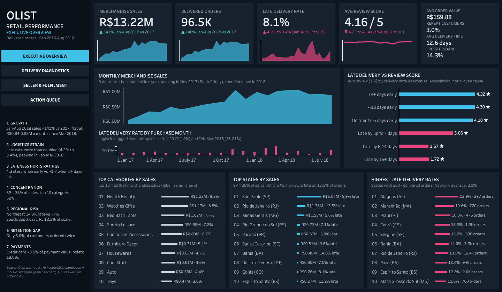
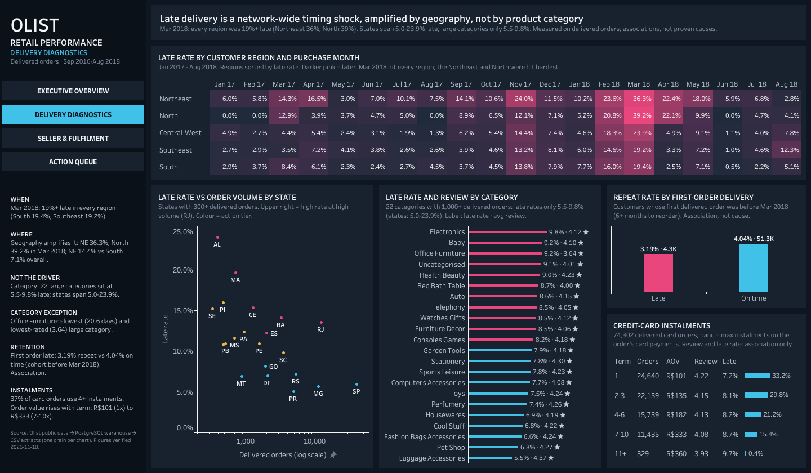
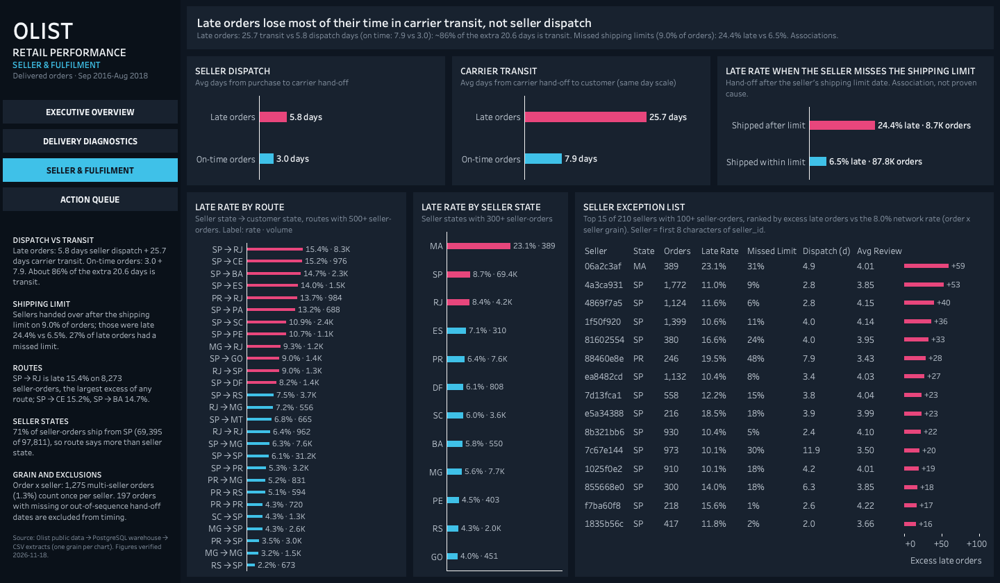
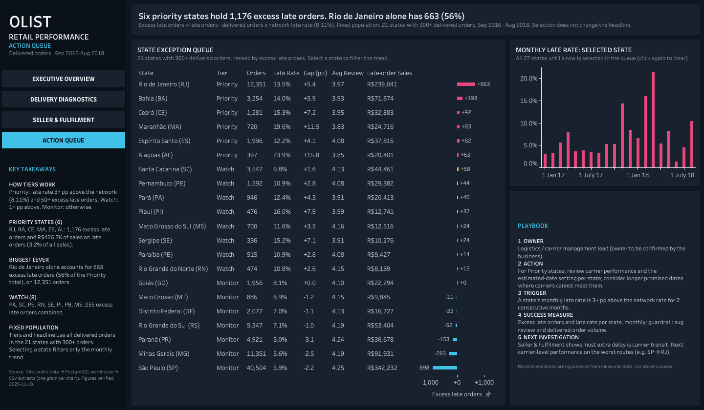

# Retail Business Intelligence Platform (Olist)

End-to-end analytics project on the public [Brazilian E-Commerce Public Dataset by Olist](https://www.kaggle.com/datasets/olistbr/brazilian-ecommerce): raw CSVs → tested PostgreSQL warehouse → grain-safe extracts → a four-page Tableau dashboard generated from code and validated in Tableau Desktop.

---

## 30-second summary

* **Question:** where and why do deliveries run late, and which states, routes and sellers should operations fix first?
* **Answer (delivered orders, Sep 2016 – Aug 2018):** 8.11% of 96,478 orders arrived late. The Mar 2018 spike hit every region, so it was network-wide. Late orders spent **25.7 days in carrier transit vs 7.9** for on-time orders, while seller dispatch adds 2.8 days, so most of the extra delay is transit. **Six states hold 1,176 excess late orders vs the network rate; Rio de Janeiro alone holds 663**, and SP → RJ is the worst large route (15.4% late).
* **Deliverable:** [`tableau/Olist Executive Dashboard.twbx`](tableau/) (status → drivers → action), generated by a standard-library Python script and validated in Tableau 2026.3: 0 schema errors, 0 query errors, mark counts as expected, and visual QA from screenshots. Full spec and QA: [docs/tableau_build_spec.md](docs/tableau_build_spec.md).

| Capability | Status |
|------------|--------|
| Dataset inventory & profiling | **Verified** ([docs/data_profile.md](docs/data_profile.md)) |
| PostgreSQL warehouse (`raw` → `staging` → `analytics`) | **Tested**: two local builds, row counts reconciled |
| Automated tests | **Tested**: 129 passed against the local warehouse (recorded in [docs/progress.md](docs/progress.md)) |
| Tableau dashboard (4 pages) | **Validated**: opens, queries and renders as specified; click/hover interaction checks pending |
| Dockerised PostgreSQL | **Implemented; unverified** (Docker not available on the build machine) |
| Power BI report (`.pbix`) | **Planned**: specs only; Tableau was chosen as the delivered BI tool |

---

## What this project demonstrates

| Skill | Evidence in this repository |
|---|---|
| **(a) Turning business questions into analytical approaches** | Decision brief, decision statement, KPI contract and dashboard story (status → drivers → action) in [docs/tableau_build_spec.md](docs/tableau_build_spec.md) §1–5. Each page answers one question with a stated comparator, such as the network late rate or Jan–Aug year on year. Business requirements: [docs/business_requirements.md](docs/business_requirements.md). |
| **(b) Assessing data quality, definitions and sources** | [docs/data_quality_report.md](docs/data_quality_report.md) and [docs/data_profile.md](docs/data_profile.md). The KPI scope decision is ADR-007 (delivered orders only) and the extract design is ADR-008 ([docs/decisions.md](docs/decisions.md)). The carrier hand-off date was profiled before use: 2 null, 165 before purchase, 23 after delivery, 197 orders excluded from timing. Credit-card instalments were profiled too (2 orders with 0 instalments excluded; 282 orders with several card rows resolved by MAX). Every exclusion is documented in [tableau/export_tableau_data.sql](tableau/export_tableau_data.sql). |
| **(c) Visualisation and reporting of complex findings** | Four dashboard pages (screenshots below) with finding-led headlines and fixed, stated populations. Tooltips carry units and volumes, and associations are labelled as such. Metric definitions are in [tableau/README.md](tableau/README.md). |
| **(d) Code and automation for reproducible insight, with guardrails** | The workbook XML is generated by [tableau/build_tableau_workbook.py](tableau/build_tableau_workbook.py) (standard library only) from single-grain extracts. The extracts are never joined in Tableau, so there is no fan-out. The warehouse build is [scripts/build_warehouse.py](scripts/build_warehouse.py), with tests in [tests/](tests/). The work used an AI-assisted workflow with explicit role prompts ([agents/](agents/)) and verification guardrails: every on-screen figure is recomputed from the extracts or SQL, each regeneration is opened in Tableau and checked through its logs and screenshots, and status labels are claimed only when observed. |
| **(e) Collaboration and reusable assets** | Architecture decision records ([docs/decisions.md](docs/decisions.md)), a running evidence log ([docs/progress.md](docs/progress.md)), a build spec a Tableau developer can maintain without guessing, a QA table with expected vs observed results and pass/fail/pending per check ([docs/tableau_build_spec.md](docs/tableau_build_spec.md) §8), and a reusable generator (data sources, calculations and layout as code). |

---

## Dashboard screenshots

Tableau Desktop 2026.3, 1440 × 840 canvas, captured from the generated workbook. Source: [`tableau/screenshots/`](tableau/screenshots/).

**1. Executive Overview:** KPI cards with Jan–Aug year-on-year deltas, sales and late-rate trends, review score by delivery timing, and ranked categories and states.


**2. Delivery Diagnostics:** late rate by region × month, state rate vs volume, categories, repeat rate by first-order delivery, and credit-card instalments.


**3. Seller & Fulfilment:** lead time split into seller dispatch vs carrier transit, shipping-limit misses, routes, seller states, and a seller exception list.


**4. Action Queue:** state exception queue ranked by excess late orders, with Priority/Watch/Monitor tiers, a monthly trend filtered by selection, and a playbook.


---

## Key insights (verified)

All figures were recomputed from the warehouse extracts on 2026-11-18. Scope: delivered orders, purchased Sep 2016 – Aug 2018, BRL.

| Area | Finding | Evidence type |
|---|---|---|
| Growth | Jan–Aug 2018 merchandise sales R$7.22M, +141% vs Jan–Aug 2017. Monthly sales flat at R$0.84–0.98M since Mar 2018 | Measured |
| Delivery | Late rate 4.2% → 9.4% (Jan–Aug 2017 vs 2018); 8.11% overall. Mar 2018 was 19%+ late in every region (Northeast 36.3%, North 39.2%) | Measured |
| Where | States with 300+ orders range from 5.0% to 23.9% late; the 22 categories with 1,000+ orders only from 5.5% to 9.8% | Measured |
| Why (time split) | Late orders: 5.8 days seller dispatch + 25.7 days carrier transit; on-time orders: 3.0 + 7.9. About 86% of the extra 20.6 days is transit | Measured (96,281 orders with a consistent hand-off date) |
| Sellers | Hand-off after the seller's shipping limit on 9.0% of orders, which were late 24.4% of the time vs 6.5% | Association |
| Routes | SP → RJ is late 15.4% on 8,273 seller-orders, the largest excess of any route | Measured |
| Action | Six Priority states (RJ, BA, CE, MA, ES, AL) hold 1,176 excess late orders and R$426.7K of sales on late orders. RJ alone holds 663 | Reconciled contribution vs network rate |
| Customers | Review 4.29 for on-time vs 2.57 for late orders. Repeat rate 3.19% when the first order was late vs 4.04% when on time (first orders before Mar 2018) | Association |
| Credit | 37% of card orders use 4+ instalments; average order value rises from R$101 (1x) to R$333 (7–10x) | Measured |

Recommendations and limitations: [docs/recommendations.md](docs/recommendations.md) · [docs/limitations_assumptions.md](docs/limitations_assumptions.md).

---

## How to run

```bash
# 1. Build the warehouse (replaces project warehouse tables; see docs/setup.md for connection variables)
python scripts/build_warehouse.py --rebuild
# 2. Export the grain-safe Tableau extracts (PGHOST/PGPORT/PGDATABASE point at the warehouse)
psql -v ON_ERROR_STOP=1 -f tableau/export_tableau_data.sql
# 3. Generate the workbook (standard library only), then open it
python3 tableau/build_tableau_workbook.py
open "tableau/Olist Executive Dashboard.twbx"
# 4. Tests
pytest tests/ -q
```

---

## Business problem

Marketplace operators need a single, trustworthy view of merchandise sales, freight, customers, delivery performance, and product mix. Olist publishes a rich public extract, but it is fragmented across nine CSVs with known data-quality quirks (duplicate geolocation rows, non-unique `review_id`, order-scoped `customer_id`). Without a layered warehouse and clear KPI definitions, stakeholders risk double-counting revenue, confusing payments with merchandise GMV, or treating correlation as causation on delivery vs reviews.

---

## Project objectives

1. Ingest the nine official Olist CSVs without inventing fields.
2. Model a three-layer PostgreSQL warehouse: `raw` → `staging` → `analytics`.
3. Publish fact/dimension tables suitable for Power BI Import mode.
4. Define KPIs that distinguish merchandise revenue, freight, and payments — never profit (no COGS).
5. Document analytical findings and recommendations with explicit limitations.
6. Keep the repository reproducible: no secrets, no large raw CSVs in Git, clear setup path.

---

## Technology stack

| Layer | Technology | Status |
|-------|------------|--------|
| Source data | Olist CSVs (Kaggle) | Local files present; gitignored |
| Language / ETL | Python, Pandas, `psycopg` | Profiling/BA and canonical raw load **Implemented** |
| Database | PostgreSQL | Local PostgreSQL build **Tested** |
| Orchestration | Docker Compose + SQL scripts | Compose **Implemented; unverified**; SQL runners **Tested** |
| BI (delivered) | Tableau Desktop 2026.3, workbook generated from Python | **Validated** (4 pages) |
| BI (alternative) | Power BI Desktop (Import) | Artefacts **Implemented**; `.pbix` **Planned** |
| Testing | pytest | 129 tests **passed** against local PostgreSQL |
| Config | `.env` + `config/defaults.yaml` | **Implemented** |

---

## Architecture

```
┌──────────────────┐     ┌─────────────────────┐     ┌────────────────────────────────┐
│  Olist CSVs      │────▶│  Load (Python/COPY) │────▶│  PostgreSQL                    │
│  data/raw/       │     │  etl/  [Planned]    │     │  raw → staging → analytics     │
│  [immutable]     │     └─────────────────────┘     └───────────────┬────────────────┘
└──────────────────┘                                                 │
                                                                     ▼
                                   ┌──────────────────────────────────────────────────┐
                                   │ tableau/export_tableau_data.sql → 7 single-grain │
                                   │ CSV extracts → build_tableau_workbook.py → .twbx │
                                   │ (Tableau, validated)   ·   Power BI [Planned]    │
                                   └──────────────────────────────────────────────────┘
```

Canonical schemas (ADR-005): **`raw`** (TEXT landing) → **`staging`** (typed/cleaned) → **`analytics`** (star schema + views).  
Detail: [docs/architecture.md](docs/architecture.md) · [docs/database_schema.md](docs/database_schema.md)

---

## Dataset source

| Item | Detail |
|------|--------|
| Dataset | [Brazilian E-Commerce Public Dataset by Olist](https://www.kaggle.com/datasets/olistbr/brazilian-ecommerce) |
| Scope | Nine core CSVs only (Marketing Funnel excluded — ADR-001) |
| Local path | `data/raw/` (contents gitignored; `.gitkeep` kept) |
| Acquisition | [docs/data_acquisition.md](docs/data_acquisition.md) |
| Profile | [docs/dataset_profiling.md](docs/dataset_profiling.md) |

Observed purchase window (profile): **2016-09-04 → 2018-10-17**. Commercial BA analysis uses **delivered** orders primarily.

---

## Key features

- **Layered warehouse** with contracts for raw/staging and a documented star schema.
- **Evidence-based profiling** scripts and reports (nulls, keys, orphans, geo collapse rules).
- **KPI dictionary** with SQL patterns and offline baselines from source CSVs.
- **Power BI package**: page specs, DAX measures, Power Query M, theme, validation SQL.
- **Governance**: ADRs, phase plan, coding standards, no secrets in Git.

---

## Repository structure

```
satyam_project/
├── config/                 # Non-secret defaults
├── data/raw/               # Olist CSVs (gitignored content)
├── data/processed/         # Reserved (gitignored)
├── database/               # Canonical SQL: schemas, staging, marts, views, seeds
├── docs/                   # Project, technical, and business documentation
├── etl/                    # Provisional ETL package (different schema contract)
├── powerbi/                # Connection, DAX, M, page specs, theme
├── scripts/                # Profiling and offline BA helpers
├── sql/                    # Pointer only — do not fork DDL here
├── tableau/                # Extract SQL, workbook generator, .twbx, screenshots
├── tests/                  # pytest helpers + raw ingestion tests
├── .env.example
├── requirements.txt
└── README.md
```

---

## Installation

### Prerequisites

- Python 3.11+ recommended
- PostgreSQL 14+ and the `psql` client (local or Docker)
- Power BI Desktop (Windows) for the report build
- Optional: Kaggle CLI to download CSVs

### Steps

1. **Clone** this repository.
2. **Create a virtualenv and install dependencies:**

   ```bash
   python -m venv .venv
   # Windows: .venv\Scripts\activate
   # macOS/Linux: source .venv/bin/activate
   pip install -r requirements.txt
   ```

3. **Configure environment:**

   ```bash
   cp .env.example .env
   # Edit POSTGRES_* values. Never commit .env.
   ```

4. **Acquire data** into `data/raw/` — see [docs/data_acquisition.md](docs/data_acquisition.md) and [docs/setup.md](docs/setup.md).

5. **Database runtime** — start PostgreSQL with `docker compose up -d`, or use a dedicated local database. See [docs/setup.md](docs/setup.md).

Full setup: **[docs/setup.md](docs/setup.md)**

---

## Execution

### Profile raw CSVs (Implemented)

```bash
python scripts/profile_olist_csvs.py
# → docs/data_profile.md , docs/data_profile_raw.json
```

### Offline business analysis (Implemented)

```bash
python scripts/ba_analysis.py
# → docs/_analysis_cache.json (feeds business_insights)
```

### Build the warehouse

Start a dedicated PostgreSQL database and set the connection variables described in [docs/setup.md](docs/setup.md), then run:

```bash
python scripts/build_warehouse.py --rebuild
```

**This replaces the project warehouse tables and their data.** It validates the nine source headers and row counts, loads raw data, then builds staging, analytics and reporting views. It is a full rebuild, not an atomic refresh of an existing live warehouse. The older `etl/` package uses a different schema and is not the canonical loader.

### Refresh analytics only (after raw load)

```bash
psql -h $POSTGRES_HOST -U $POSTGRES_USER -d $POSTGRES_DB -v ON_ERROR_STOP=1 -f database/scripts/01_refresh_analytics.sql
```

### Tableau dashboard (Validated)

```bash
psql -v ON_ERROR_STOP=1 -f tableau/export_tableau_data.sql   # PG* env vars point at the warehouse
python3 tableau/build_tableau_workbook.py
open "tableau/Olist Executive Dashboard.twbx"
```

Details, metric definitions and verification: [tableau/README.md](tableau/README.md).

### Power BI (Planned binary)

Follow [powerbi/CONNECTION.md](powerbi/CONNECTION.md) and [powerbi/BUILD_GUIDE.md](powerbi/BUILD_GUIDE.md) once `analytics` is populated. Connect **Import** mode to schema `analytics` only.

### Tests

```bash
pytest tests/ -q
```

See [docs/testing.md](docs/testing.md) for markers and current coverage. Do not treat this README as evidence that CI is green.

---

## Documentation index

| Document | Purpose |
|----------|---------|
| [docs/architecture.md](docs/architecture.md) | System design & contracts |
| [docs/project_plan.md](docs/project_plan.md) | Phases, owners, acceptance |
| [docs/progress.md](docs/progress.md) | Status log with evidence |
| [docs/decisions.md](docs/decisions.md) | ADRs |
| [docs/dataset_profiling.md](docs/dataset_profiling.md) | Profiling summary & how to re-run |
| [docs/data_dictionary.md](docs/data_dictionary.md) | Source + warehouse field dictionary |
| [docs/database_schema.md](docs/database_schema.md) | Layers, facts, dims, keys, grain |
| [docs/etl_documentation.md](docs/etl_documentation.md) | Extract / clean / load / rerun |
| [docs/setup.md](docs/setup.md) | Install & environment |
| [docs/testing.md](docs/testing.md) | Test strategy & status |
| [docs/tableau_build_spec.md](docs/tableau_build_spec.md) | Tableau decision brief, KPI contract, build spec, QA |
| [tableau/README.md](tableau/README.md) | Tableau dashboard, extracts, definitions, rebuild |
| [docs/bi_documentation.md](docs/bi_documentation.md) | Power BI connection, model, DAX, pages |
| [docs/kpi_definitions.md](docs/kpi_definitions.md) | KPI definitions |
| [docs/business_insights.md](docs/business_insights.md) | Analytical findings |
| [docs/recommendations.md](docs/recommendations.md) | Business recommendations |
| [docs/limitations_assumptions.md](docs/limitations_assumptions.md) | Limitations & assumptions |

---

## Future improvements

| Item | Status |
|------|--------|
| Verify `docker-compose.yml` on Docker | Pending |
| Canonical CSV warehouse rebuild | Tested locally; separate `etl/` package remains provisional |
| Warehouse build and row-count reconciliation | Tested locally |
| PostgreSQL and raw-data tests | 129 passed locally |
| Resolve BA “delivered-only” vs BI “non-canceled” filter | Pending ADR / Phase 7 |
| Build and publish `.pbix` (Tableau delivered instead) | Planned |
| Click/hover QA of Tableau actions, navigation buttons and tooltips | Pending (needs a person at the screen) |
| Power BI Service gateway + scheduled refresh | Planned |
| Incremental refresh / orchestration (Airflow etc.) | Out of scope for MVP |

---

## Engineering rules

- Never invent dataset fields or metrics.
- Keep `data/raw/` immutable.
- Secrets only via environment variables (`.env` gitignored).
- Shared DB contracts change only via ADR in `docs/decisions.md`.
- Status language: **Planned · In progress · Implemented · Tested · Verified**.

## License note

Olist data is subject to its Kaggle dataset terms. This repository does **not** redistribute the CSVs.
