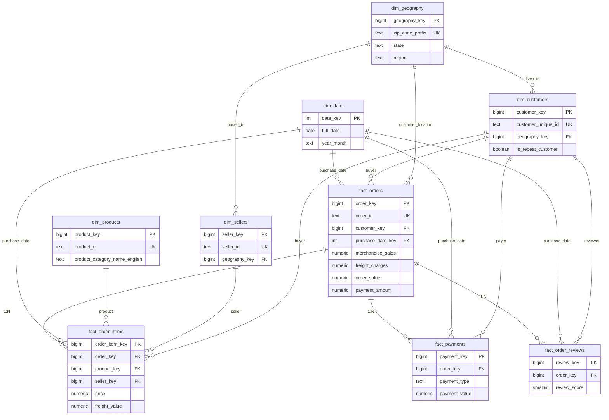

# ER Diagrams

## Source (relational) model

```mermaid
erDiagram
    CUSTOMERS ||--o{ ORDERS : places
    ORDERS ||--|{ ORDER_ITEMS : contains
    ORDERS ||--o{ ORDER_PAYMENTS : paid_by
    ORDERS ||--o{ ORDER_REVIEWS : reviewed_as
    PRODUCTS ||--o{ ORDER_ITEMS : sold_as
    SELLERS ||--o{ ORDER_ITEMS : fulfills
    GEOLOCATION ||--o| CUSTOMERS : "zip approx"
    GEOLOCATION ||--o| SELLERS : "zip approx"
    CATEGORY_TRANSLATION ||--o| PRODUCTS : translates

    CUSTOMERS {
        text customer_id PK
        text customer_unique_id
        text customer_zip_code_prefix
        text customer_city
        text customer_state
    }
    ORDERS {
        text order_id PK
        text customer_id FK
        text order_status
        timestamp order_purchase_timestamp
    }
    ORDER_ITEMS {
        text order_id PK_FK
        int order_item_id PK
        text product_id FK
        text seller_id FK
        numeric price
        numeric freight_value
    }
    ORDER_PAYMENTS {
        text order_id PK_FK
        int payment_sequential PK
        text payment_type
        numeric payment_value
    }
    ORDER_REVIEWS {
        text review_id
        text order_id FK
        int review_score
    }
    PRODUCTS {
        text product_id PK
        text product_category_name
    }
    SELLERS {
        text seller_id PK
        text seller_zip_code_prefix
    }
    GEOLOCATION {
        text geolocation_zip_code_prefix
        numeric geolocation_lat
        numeric geolocation_lng
    }
    CATEGORY_TRANSLATION {
        text product_category_name PK
        text product_category_name_english
    }
```

## Analytics star schema



## Power BI relationship map

| From | To | Key | Cardinality |
|------|----|-----|-------------|
| fact_orders | dim_customers | customer_key | many:1 |
| fact_orders | dim_date | purchase_date_key → date_key | many:1 |
| fact_orders | dim_geography | customer_geography_key | many:1 |
| fact_order_items | fact_orders | order_key | many:1 |
| fact_order_items | dim_products | product_key | many:1 |
| fact_order_items | dim_sellers | seller_key | many:1 |
| fact_order_items | dim_customers | customer_key | many:1 |
| fact_order_items | dim_date | purchase_date_key | many:1 |
| fact_payments | fact_orders | order_key | many:1 |
| fact_payments | dim_date | purchase_date_key | many:1 |
| fact_order_reviews | fact_orders | order_key | many:1 |

**Recommendation:** In Power BI, hide raw surrogate duplicates and prefer connecting visuals to `analytics.vw_*` / `analytics.mv_*` for KPI pages; use star tables for flexible slicing.
