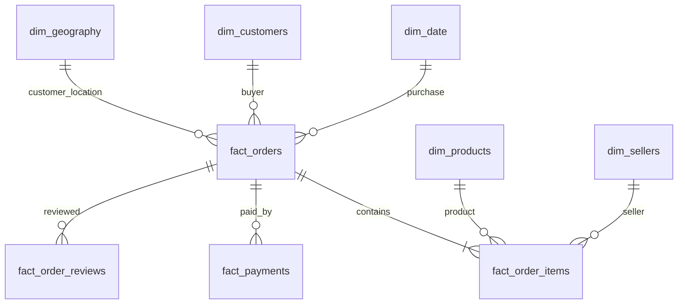

# Database schema

**Status:** Implemented as SQL under `database/` — **not Verified** against a running PostgreSQL instance in the current repo state (no Docker Compose / no accepted live load).  
**Canonical tree:** `database/` (ADR-005)  
**Detailed SQL docs:** [`../database/docs/schema_documentation.md`](../database/docs/schema_documentation.md), [`../database/docs/er_diagram.md`](../database/docs/er_diagram.md)

---

## Database layers

| Schema | Role | Load style | Consumers |
|--------|------|------------|-----------|
| `raw` | Landing zone — CSV mirror as TEXT + `_loaded_at` | Truncate + COPY (Planned Python / manual `\copy`) | Staging transforms only |
| `staging` | Typed, cleaned entities; business rules applied | `TRUNCATE` + `INSERT` SQL | Mart builds only |
| `analytics` | Star schema dims/facts + reporting views/MVs | Truncate/reload marts | Power BI, analysts |

```
data/raw/*.csv  →  raw.*  →  staging.stg_*  →  analytics.dim_* / fact_*  →  Power BI
```

DDL entry points:

1. `database/schemas/00_create_schemas.sql`
2. `database/schemas/01_raw_tables.sql`
3. `database/schemas/02_staging_tables.sql`
4. `database/schemas/03_analytics_tables.sql`
5. `database/schemas/04_indexes.sql`

Orchestration: `database/scripts/00_run_all.sql` (expects raw data loaded after raw DDL).

---

## Dimension tables

| Table | Grain | Natural key | Surrogate PK | SCD |
|-------|-------|-------------|--------------|-----|
| `dim_date` | One calendar day | `full_date` / `date_key` | `date_key` (YYYYMMDD) | Generated seed |
| `dim_geography` | One zip prefix | `zip_code_prefix` | `geography_key` | Type 1 |
| `dim_customers` | One unique customer | `customer_unique_id` | `customer_key` | Type 1 |
| `dim_products` | One product | `product_id` | `product_key` | Type 1 |
| `dim_sellers` | One seller | `seller_id` | `seller_key` | Type 1 |

SCD Type 1 justification: public extract is a fixed historical snapshot with no change history.

---

## Fact tables

| Table | Grain | Natural key | Surrogate PK |
|-------|-------|-------------|--------------|
| `fact_orders` | One order | `order_id` | `order_key` |
| `fact_order_items` | One order line | (`order_id`, `order_item_id`) | `order_item_key` |
| `fact_payments` | One payment sequence | (`order_id`, `payment_sequential`) | `payment_key` |
| `fact_order_reviews` | One review instance | staging `review_sk` / surrogate | `review_key` |

### Table grain notes

- **`fact_orders` monetary measures are pre-aggregated** (SUM of items / payments) so joining payments or items at order grain does not fan out revenue on the order fact itself.
- **Product / seller revenue** must use **`fact_order_items`**, not payments joined to items.
- **`fact_orders.review_score`** holds a latest/primary score for convenience; **all reviews** live in `fact_order_reviews`.
- **Profit / COGS does not exist** in this model.

---

## Primary keys and foreign keys

### Primary / unique keys (analytics)

| Table | PK | Unique business key |
|-------|----|---------------------|
| `dim_date` | `date_key` | `full_date` |
| `dim_geography` | `geography_key` | `zip_code_prefix` |
| `dim_customers` | `customer_key` | `customer_unique_id` |
| `dim_products` | `product_key` | `product_id` |
| `dim_sellers` | `seller_key` | `seller_id` |
| `fact_orders` | `order_key` | `order_id` |
| `fact_order_items` | `order_item_key` | (`order_id`, `order_item_id`) |
| `fact_payments` | `payment_key` | (`order_id`, `payment_sequential`) |
| `fact_order_reviews` | `review_key` | (surrogate; `review_id` alone not unique) |

### Foreign keys (analytics)

| From | Column | To |
|------|--------|----|
| `dim_customers` | `geography_key` | `dim_geography.geography_key` |
| `dim_sellers` | `geography_key` | `dim_geography.geography_key` |
| `fact_orders` | `customer_key` | `dim_customers.customer_key` |
| `fact_orders` | `customer_geography_key` | `dim_geography.geography_key` |
| `fact_orders` | `purchase_date_key` | `dim_date.date_key` |
| `fact_order_items` | `order_key` | `fact_orders.order_key` |
| `fact_order_items` | `product_key` / `seller_key` / `customer_key` | respective dims |
| `fact_order_items` | `purchase_date_key` | `dim_date.date_key` |
| `fact_payments` | `order_key`, `customer_key`, `purchase_date_key` | facts/dims |
| `fact_order_reviews` | `order_key`, `customer_key`, date keys | facts/dims |

Additional CHECK: `review_score` between 1 and 5 on review fact (see DDL).

---

## Table relationships (star)



Power BI should relate facts → dims on surrogate keys. Prefer connecting interactive visuals to base star tables; use `analytics.vw_*` / `mv_*` for SQL KPI parity checks.

---

## Data transformation logic (summary)

| Step | Location | Logic |
|------|----------|-------|
| Raw load | Planned `etl/` / `\copy` | TEXT columns; `_loaded_at` default |
| Staging orders | `database/staging/stg_orders.sql` | TRIM; cast timestamps; lower status; derive `delivery_days`, `is_late_delivery`, flags |
| Staging geo | `stg_geolocation.sql` | Collapse to one row per zip; AVG lat/lng; drop full-row dup noise |
| Staging reviews | `stg_order_reviews.sql` | Surrogate `review_sk`; score typing; `has_comment` |
| Staging products | `stg_products.sql` | Correct length spellings; join EN category |
| Seeds | `database/seeds/` | Brazilian states/regions; `dim_date` via `generate_series` |
| Marts | `database/marts/*.sql` | Surrogate keys; FK resolution; pre-agg order measures |
| Views / MVs | `database/views/` | KPI views; monthly sales MV |

Full cleaning rules: [`etl_documentation.md`](etl_documentation.md).

---

## Indexes and performance

Indexes target fact FK columns and common filters (`order_status`, `payment_type`, `review_score`, state). See `database/schemas/04_indexes.sql` and sample plans in `database/scripts/explain_analyze_samples.sql` (**not executed** until a live DB exists).

---

## Rerun safety

- DDL uses drop/create patterns inside transactions where defined.
- Transforms use `TRUNCATE` + `INSERT` (or `ON CONFLICT DO NOTHING` where noted).
- Seeds truncate and reload.
- Full rebuild path: `database/scripts/00_run_all.sql` after raw load.
- Analytics-only refresh: `database/scripts/01_refresh_analytics.sql`.

---

## Known documentation inconsistencies

| Item | Canonical value |
|------|-----------------|
| Schema names | `raw` / `staging` / `analytics` (not `dw` / `marts`) |
| Database name in `.env.example` | `olist_bi` |
| Older script comments | May still say `olist_dw` — use env value |
